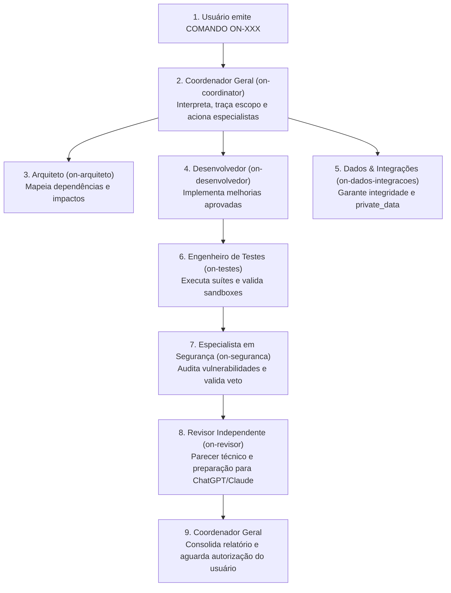

# GOVERNANÇA MULTIAGENTE PERMANENTE — ON AGÊNCIA DE EVENTOS

**Projeto:** Sistema de Gestão ON Agência de Eventos  
**Repositório:** `thiagooriginal/on-eventos`  
**Branch de Referência de Segurança:** `security/hardening-phase-1`  
**Metodologia:** Equipe Multiagente Permanente com Especialistas Independentes e Dupla Camada Externa de Auditoria (ChatGPT e Claude).

---

## 1. ESTRUTURA DA EQUIPE PERMANENTE

A governança do projeto é composta por um Coordenador Geral e seis especialistas técnicos com domínios de atuação delimitados, garantindo segregação de funções (Separation of Concerns) e defesa em profundidade:

| Identificador | Agente | Domínio / Responsabilidade Principal | Poder de Veto |
| :--- | :--- | :--- | :---: |
| **AGENTE 01** | **Coordenador Geral** (`on-coordinator`) | Recepção de comandos (ON-XXX), orquestração, consolidação e governança. | Sim (Escopo/Aprovação) |
| **AGENTE 02** | **Arquiteto de Sistemas** (`on-arquiteto`) | Next.js, React, TypeScript, PHP, modularidade, dependências e arquitetura. | Não |
| **AGENTE 03** | **Desenvolvedor Full-Stack** (`on-desenvolvedor`) | Implementação técnica de código, correções de bugs, frontend e backend. | Não |
| **AGENTE 04** | **Especialista em Cibersegurança** (`on-seguranca`) | OWASP ASVS, autenticação HttpOnly, CSRF, PoLP, RBAC, Rate Limit e criptografia. | **SIM (VETO CRÍTICO)** |
| **AGENTE 05** | **Banco de Dados & Integrações** (`on-dados-integracoes`) | `private_data`, persistência atômica, integridade de vendas, Sicredi e WhatsApp. | **SIM (Perda de Dados)** |
| **AGENTE 06** | **Engenheiro de Testes** (`on-testes`) | Suítes automatizadas, testes de regressão, homologação isolada e PHP real. | **SIM (Falha em Testes)** |
| **AGENTE 07** | **Revisor Técnico Independente** (`on-revisor`) | Revisão cega de código, análise de manutenibilidade, conformidade e parecer final. | Não |

---

## 2. REGRAS INVIOLÁVEIS DE GOVERNANÇA

1. **Protocolo de Comandos Sequenciais**: Toda demanda do usuário deve ser registrada sequencialmente como `COMANDO ON-001`, `COMANDO ON-002`, `COMANDO ON-003`, etc.
2. **Avaliação Obrigatória pelo Coordenador**: Nenhuma alteração de código ou diagnóstico é iniciado sem o roteamento formal pelo Agente 01.
3. **Poder de Veto de Segurança**: O Especialista em Cibersegurança (`on-seguranca`) possui poder de veto terminativo caso qualquer vulnerabilidade P0 (Crítica) ou P1 (Alta) seja identificada. Nenhuma exceção de segurança é tolerada.
4. **Preservação Absoluta de Dados Reais**: É terminantemente proibido truncar, apagar ou sobrescrever arquivos reais de clientes, vendas, fotos ou cadastros (`vendas_albuns_db.json`, planilhas e `private_data`). Todas as operações de persistência devem utilizar fusão inteligente (`mesclarColecaoVendas` / `array_merge` mapeado).
5. **Proteção da Produção e da Branch `main`**:
   - É estritamente proibido realizar deploy automático em produção sem autorização expressa e nominal do usuário.
   - É proibido realizar merge na branch `main` sem conclusão e homologação de todas as etapas.
   - Qualquer trabalho de segurança ou desenvolvimento deve permanecer em branch de feature/hardening (ex: `security/hardening-phase-1`).
6. **Testes Obrigatórios com Sandboxes Isoladas**: Nenhuma alteração é considerada pronta sem execução comprovada das quatro suítes automatizadas: Funcional, Endurecimento, Homologação e Integração Real PHP.

---

## 3. PROTOCOLO DE AUDITORIA EXTERNA (CHATGPT & CLAUDE)

Para garantir máxima isenção e qualidade arquitetural, o projeto opera com duas camadas externas de validação:

### Camada 1: ChatGPT (Auditoria Contínua via GitHub & Pull Requests)
- O ChatGPT analisa diretamente os commits e Pull Requests abertos no repositório GitHub.
- Atua como consultor de planejamento, arquitetura geral e revisão de conformidade de requisitos.

### Camada 2: Claude (Segunda Camada Independente de Segurança & Código)
- **Status da Integração Técnica no Antigravity**: O runtime atual do Antigravity suporta nativamente subagentes com modelos da família Google (`inherit`, `flash_lite`, `flash`, `pro`), não disponibilizando execução direta de modelos externos proprietários de terceiros na sua API interna de subagentes.
- **Protocolo Operacional Honesto e Sem Simulação**:
  - Em estrito cumprimento às instruções do usuário, a equipe **NUNCA simula nem forja** pareceres do Claude.
  - Para cada comando relevante, o Coordenador e o Revisor Técnico compilam um **Pacote de Auditoria Claude** contendo:
    1. Sumário executivo do comando e escopo.
    2. Relatório de alterações e diffs unificados.
    3. Resultados das baterias de testes automatizados.
    4. Prompt estruturado de revisão para auditoria externa no Claude.
  - O usuário ou a esteira externa submete o pacote ao Claude, e o retorno real do Claude é anexado à governança do projeto.

---

## 4. CICLO DE VIDA DE UM COMANDO ON-XXX

---

## 5. LOCALIZAÇÃO DOS PAPEIS E HABILIDADES

- Funções dos Agentes: `.agents/roles/*.md`
- Habilidades Reutilizáveis: `.agents/skills/on-teamwork/SKILL.md`
- Suítes de Testes: `security/*-test.mjs`
- Diretório de Armazenamento Seguro: `private_data/`
