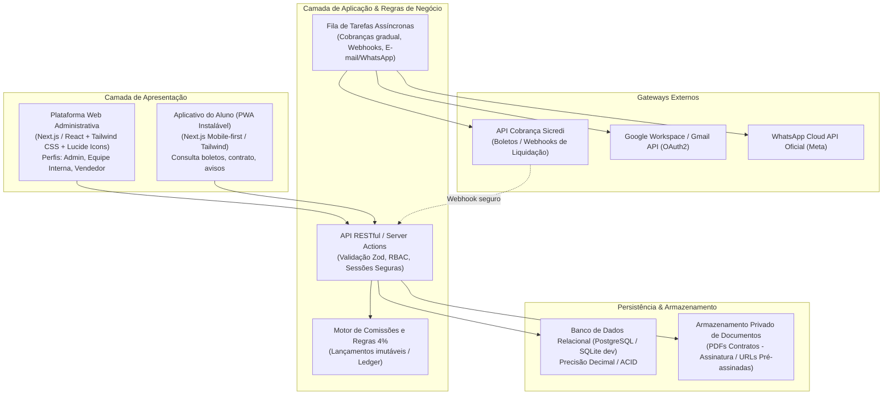
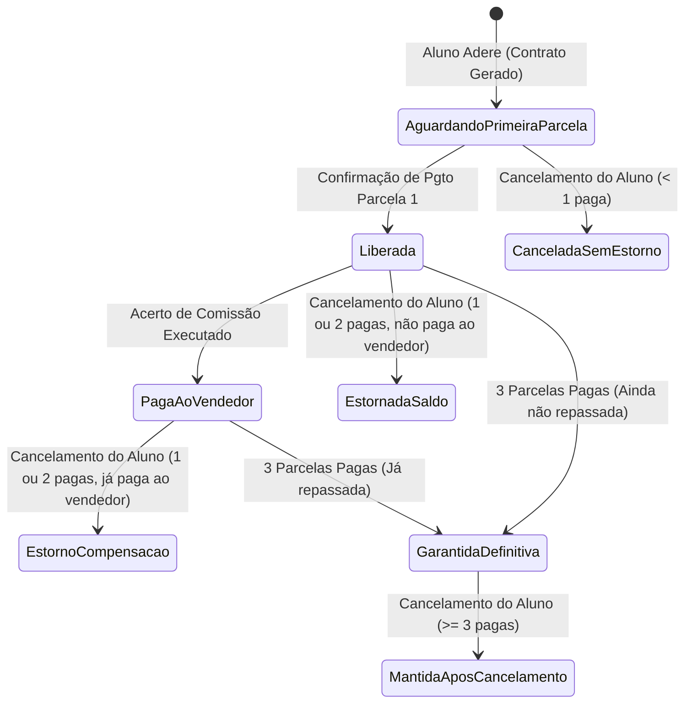
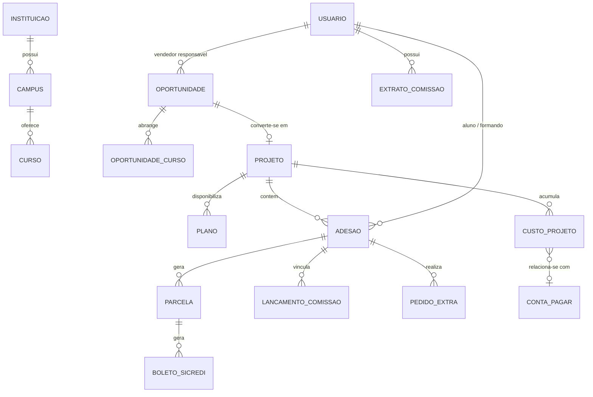

# Sistema de Gestão de Formaturas — Arquitetura, Modelagem e Plano Técnico

Este documento consolida a arquitetura de solução, modelagem do domínio, respostas para decisões em aberto, regras financeiras críticas e o plano de implementação do Sistema de Gestão de Formaturas e Colações de Grau.

---

## 1. Visão Geral da Arquitetura Proposta

Para garantir **simplicidade operacional**, **isolamento de segurança**, **precisão contábil** e suporte imediato tanto à plataforma web administrativa quanto ao aplicativo do aluno, propõe-se a seguinte stack tecnológica:

### Justificativas Técnicas:
1. **Full-stack TypeScript (Next.js / Node.js + Prisma ou Drizzle ORM)**: Tipagem estrita de ponta a ponta, compartilhando esquemas de validação (Zod) entre Web, App do Aluno e Backend.
2. **Aplicativo do Aluno como PWA (Progressive Web App)**: Atende de imediato à exigência de existir desde o início sem atrito de aprovação em lojas (Google Play / App Store), permitindo instalação no smartphone (ícone na tela inicial, push notifications, offline manifest), com design mobile-first nativo e sem custos extras imediatos de publicação.
3. **Persistência Relacional com Precisão Decimal**: Moedas representadas em inteiros (centavos) ou tipos `DECIMAL(12, 2)` / `NUMERIC` para evitar erros de ponto flutuante IEEE 754.
4. **Isolamento de Documentos**: Contratos em PDF armazenados em bucket privado (ou diretório restrito do servidor), servidos exclusivamente via endpoints autenticados ou URLs com expiração temporária (signed URLs), sem links estáticos públicos.

---

## 2. Resolução das Lacunas e Decisões em Aberto

| Ponto em Aberto na Especificação | Proposta Técnica & Regra Recomendada | Impacto / Dependência |
| :--- | :--- | :--- |
| **Momento de disponibilização do código da turma e planos** | Gerar o `codigo_adesao` e cadastrar os **planos preliminares** diretamente na **Oportunidade Comercial (CRM)**. Ao ocorrer a 1ª adesão, a oportunidade é convertida em Projeto com o mesmo ID/Código, garantindo fluxo contínuo. | Nenhuma duplicação de dados; aluno acessa o portal de adesão informando o código da oportunidade e efetiva a entrada. |
| **Cancelamento da 1ª adesão após criação do projeto** | O Projeto permanece existente no sistema, mudando seu status para `"SEM_ADESOES_ATIVAS"` ou `"EM_NEGOCIACAO"`. **Nunca excluir o projeto** para não corromper histórico, logs de auditoria ou registros bancários. | Mantém rastreabilidade e integridade referencial. |
| **Data de assinatura do projeto** | Criar campos distintos: `data_contrato_turma` (data em que a comissão de formatura assinou o contrato mãe/termo de exclusividade) e `data_primeira_adesao` (marco automático da primeira adesão individual). | Elimina confusão entre o contrato coletivo com a comissão e os contratos individuais dos formandos. |
| **Cálculo da previsão com múltiplos planos** | Se houver mais de um plano, o sistema permitirá: (A) Definir a quantidade prevista por plano (ex: 50 do Plano Ouro, 30 do Plano Prata) OU (B) Utilizar a média ponderada / plano base como referência. No real, soma-se rigorosamente o valor contratado de cada adesão ativa. | Exibição clara no painel: *Previsão Estimada* vs *Total Efetivamente Contratado*. |
| **Tratamento de cancelamento na quantidade real** | O contador `"Alunos com Adesão Ativa"` deduz o cancelado. Cria-se um contador paralelo `"Adesões Canceladas"` e preserva-se o histórico completo do contrato com status `"CANCELADO"`. | Transparência total entre formandos vigentes e desistentes. |
| **Segunda aba da área administrativa de alunos** | Manter a 1ª aba como **"Pesquisa Geral de Alunos"** e a 2ª aba sugerida como **"Fila de Adesões Recentes & Pendências Cadastrais"** (ou "Alunos sem Turma Vinculada"). | Pode ser alterada facilmente assim que a diretoria detalhar o requisito. |
| **Venda de produtos adicionais (convites extras)** | Criar módulo desacoplado de Pedidos Extras. Disponível tanto no App do Aluno quanto na Web Administrativa. O valor do produto não compõe a base de cálculo da comissão de 4% de adesão (a menos que explicitamente configurado no produto). | Separação contábil entre receita de adesão e receita de conveniência/extras. |
| **Assinatura do contrato do aluno** | Iniciar com aceite digital auditável (Termo de Adesão com IP, Timestamp, User-Agent e Hash SHA-256 do contrato gerado em PDF), deixando arquitetura preparada para provedores externos (ex: Clicksign, D4Sign, ZapSign). | Viabiliza o lançamento sem custos de API externa antes da homologação jurídica. |
| **Boletos com Pix (Sicredi)** | Suportar emissão híbrida (Boleto com QR Code Pix integrado do Sicredi). A confirmação pode ocorrer tanto pelo Pix (imediata) quanto pela liquidação tradicional de compensação bancária. | Acelera a compensação da 1ª parcela e liberação da comissão. |
| **Inclusão de comissões nos custos do projeto** | Apresentar duas métricas transparentes: **Resultado Operacional do Evento** (Recebimentos − Custos Diretos de Fornecedores/Ações) e **Resultado Líquido do Projeto** (Resultado Operacional − Comissões Totais Pagas/Devidas). | Impede distorções e evita dupla contagem com despesas administrativas gerais. |

---

## 3. Motor Financeiro e de Comissões (Regra dos 4%)

A gestão de comissões é modelada como um **Livro-Razão Imutável (Ledger)** para garantir rastreabilidade irrefutável e evitar perdas de saldo em recálculos:

### Regras do Motor Contábil:
1. **Base de Cálculo**: `4%` sobre o valor total do contrato individual aderido (ex: R$ 5.000,00 → R$ 200,00).
2. **Gatilho de Liberação**: Webhook/confirmação de liquidação da parcela nº 1 (ou primeira cota paga).
3. **Garantia de Permanência**: Quando a 3ª parcela do formando é liquidada, o status da comissão é marcado como `GARANTIDA_DEFINITIVA`. Qualquer cancelamento futuro do formando não gera estorno nem débito.
4. **Regras de Estorno (< 3 parcelas pagas)**:
   - Se o status for `LIBERADA` (não repassada): o sistema debita do saldo pendente do vendedor através de um lançamento explícito de estorno (`ESTORNO_CANCELAMENTO`), zerando a liberação.
   - Se o status for `PAGA`: o sistema lança um débito de saldo (`DEBITO_COMPENSACAO_FUTURA`). No próximo fechamento do vendedor, se o saldo a receber for R$ 5.000,00 e houver R$ 600,00 de débitos pendentes, o extrato exibe os créditos, deduz individualmente os débitos detalhando aluno e motivo, e fecha em R$ 4.400,00. Se o saldo for insuficiente, o débito remanescente transita para o mês seguinte.

---

## 4. Modelagem de Dados Principal (Entidades & Relacionamentos)

### Destaques das Tabelas:
- **`projetos`**: `id`, `codigo_adesao` (único, indexado), `tipo` (`BAILE` | `COLACAO`), `semestre` (ex: "2026.1"), `quantidade_prevista`, `status`, `data_contrato_turma`.
- **`adesoes`**: `id`, `aluno_id`, `projeto_id`, `plano_id`, `vendedor_id`, `valor_total_contratado`, `status` (`ATIVA`, `CANCELADA`, `INADIMPLENTE`), `parcelas_pagas_count`.
- **`parcelas`**: `id`, `adesao_id`, `numero`, `valor`, `data_vencimento`, `data_pagamento`, `valor_pago`, `status` (`PENDENTE`, `PAGA`, `VENCIDA`, `CANCELADA`).
- **`lancamentos_comissao`**: `id`, `vendedor_id`, `adesao_id`, `tipo` (`CREDITO_LIBERADO`, `ESTORNO_CANCELAMENTO`, `PAGAMENTO_EFETUADO`), `valor`, `base_calculo`, `percentual`, `descricao`, `data_lancamento`.
- **`contas_pagar`**: `id`, `descricao`, `favorecido`, `categoria`, `valor`, `vencimento`, `data_pagamento`, `tipo_despesa` (`GERAL_EMPRESA` | `CUSTO_PROJETO`), `projeto_id` (nullable), `recorrente_config`.

---

## 5. Relatórios Financeiros e Visão Dupla de Inadimplência

Para atender fielmente ao requisito contábil:
1. **Visão Histórica no Fechamento**: Calcula os formandos que tinham parcelas vencidas até a data de corte do período sem considerar pagamentos posteriores.
2. **Visão Atual das Pendências**: Analisa os mesmos títulos vencidos naquele período, confrontando com as baixas registradas até a data de hoje, indicando quem quitou em atraso e quem permanece inadimplente.

---

## 6. Módulo de Campanhas (Fila com Cadência Segura)

- Suporte a **E-mail (Gmail API)** e **WhatsApp (Cloud API Oficial Meta)**.
- **Fila com Dispatcher Temporal**: Dispara mensagens com intervalo configurável (ex: a cada 45 a 120 segundos), evitando sobrecarga de quota e respeitando diretrizes dos provedores.
- **Checagem de Último Segundo (JIT Payment Check)**: Antes de enviar a notificação de cobrança agendada, o worker consulta se a parcela correspondente foi liquidada nos últimos minutos. Se foi paga, o envio é automaticamente cancelado e marcado como `"SUPRIMIDO_PAGAMENTO_CONFIRMADO"`.

---

## 7. Próximos Passos de Execução

1. **Fase 1 (Estrutura e Banco de Dados)**: Setup do projeto Next.js com Tailwind CSS, configuração do banco relacional (SQLite para dev/testes, pronto para PostgreSQL), esquema Prisma/Drizzle e seeds demonstrativos.
2. **Fase 2 (Autenticação, RBAC e CRM)**: Controle de acesso (Admin, Equipe, Vendedor, Aluno), funil de oportunidades no CRM e conversão automática para projeto na primeira adesão com código único.
3. **Fase 3 (Motor de Comissões e Finanças)**: Implementação do livro-razão de comissões dos vendedores (regras 4%, estornos, 3 parcelas pagas), contas a pagar (fixas vs projetos) e relatórios de inadimplência temporal.
4. **Fase 4 (Área do Aluno PWA e Adesão)**: Interface do aluno com consulta de boletos, contrato e avisos, e página pública de adesão guiada por código de turma.
5. **Fase 5 (Simulador e Módulos de Integração Sicredi/Comunicação)**: Adaptadores da API Sicredi (boletos/webhooks idempotentes), fila de campanhas e testes unitários das regras financeiras críticas.
